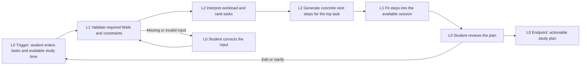

# Study Planner Workflow

This is the intentionally bounded Option 2 workflow for the Mini AI Build-a-thon. It turns a student's current workload into a short, reviewable study plan for one available study session.

## Required workflow notes

### Basic sequence

The student enters assignments, deadlines, effort estimates, priorities, dependencies, and available study time. The app validates the information, sends one structured planning request to the AI model, validates the returned plan, fits the recommended steps into the available study session, and shows an actionable plan. The student reviews the plan and can accept it or revise the inputs.

The first version owns one complete unit of work: planning one study session. It does not manage a full calendar, submit assignments, send messages, or continuously reschedule the student's life. It recommends exactly one top task, breaks that task into the current session, and places every other assignment into an ordered queue. Missing due dates and effort estimates display as `N/A`; the final remaining assignment stays last in the queue.

### AI/API tasks and automation levels

- **L2:** Interpret the student's free-text task descriptions and return a structured representation.
- **L2:** Prioritize the submitted tasks using deadline, importance, effort, dependencies, and available time.
- **L2:** Break the highest-priority task into realistic next steps and estimate each step's duration.
- **L1:** Validate identifiers, required fields, duration limits, and the final session-time total.
- **L1:** Fit the returned steps into the available study session.
- **L0:** The student reviews, accepts, or revises the plan.
- **L1:** The controller preserves all non-recommended assignments in the queue and enforces the requested final-item order.

No Level 3 task is required for the first version. The route and permitted output are predefined, so the model is performing intelligent automation inside a fixed workflow rather than choosing a new workflow path.

### Potential models and external tools

- **OpenAI Responses API with a fast text model, provisionally `gpt-5.4-mini`:** performs the L2 interpretation, prioritization, decomposition, and explanation. Confirm the exact approved identifier in the course model workbook before implementation.
- **Python or Node local backend:** keeps the API key private, validates the model response, and enforces L0-L3 workflow limits.
- **Browser dashboard:** collects the student's input and displays the plan for review.
- **JSON file:** stores a small set of demo tasks and optional accepted plans locally.
- **Calendar API, Gmail, Slack, and external task-management tools:** not used in the first version because they add authentication and side effects without improving the core demonstration.
