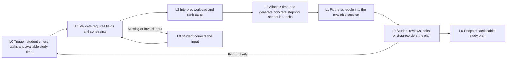

# StudyBloom Workflow

This is the intentionally bounded Option 2 workflow for the Mini AI Build-a-thon. It turns a student's current workload into a short, reviewable study plan for one available study session.

## Required workflow notes

### Basic sequence

The student enters assignments, deadlines, effort estimates, priorities, dependencies, and available study time. StudyBloom validates the information, sends one structured planning request to the AI model, validates the returned schedule, fits the assignment blocks into the available study session, and shows task-specific actions for each scheduled block. The student reviews, edits, drag-and-drops blocks to reorder them, or revises the schedule.

The first version owns one complete unit of work: planning one study session. It does not manage a full calendar, submit assignments, send messages, or continuously reschedule the student's life. It divides the session across the highest-priority assignments, places anything that does not fit into an ordered queue, reports any estimated workload overage, and recommends the highest-priority unfinished task for the next session, including a partially completed task. Missing due dates and effort estimates display as `N/A`; the final remaining assignment stays last in the queue.

### AI/API tasks and automation levels

- **L2:** Interpret the student's free-text task descriptions and return a structured representation.
- **L2:** Prioritize the submitted tasks using deadline, importance, effort, dependencies, and available time.
- **L2:** Allocate time across the highest-priority assignments and break each scheduled assignment into realistic next steps.
- **L1:** Validate identifiers, required fields, duration limits, and the final session-time total.
- **L1:** Fit the returned assignment blocks into the available study session.
- **L0:** The student reviews, accepts, or revises the plan.
- **L1:** The controller preserves all non-scheduled assignments in the queue, enforces the session limit, calculates overage, and selects the next-session recommendation.

No Level 3 task is required for the first version. The route and permitted output are predefined, so the model is performing intelligent automation inside a fixed workflow rather than choosing a new workflow path.

### Potential models and external tools

- **Anthropic Messages API with `claude-haiku-5-5`:** performs the L2 interpretation, prioritization, task-specific decomposition, queue previews, and explanation. The OpenAI Responses API adapter remains available as an optional fallback. Confirm the exact approved identifier in the course model workbook before the final showcase.
- **Python or Node local backend:** keeps the API key private, validates the model response, and enforces L0-L3 workflow limits.
- **Browser dashboard:** collects the student's input and displays the plan for review.
- **JSON file:** stores a small set of demo tasks and optional accepted plans locally.
- **Calendar API, Gmail, Slack, and external task-management tools:** not used in the first version because they add authentication and side effects without improving the core demonstration.
