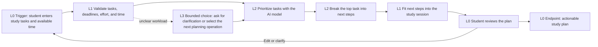

# Study Planner Workflow

## Required workflow notes

### Basic sequence

The student enters assignments, deadlines, effort estimates, priorities, dependencies, and available study time. The app validates the information, the AI prioritizes the workload, and the AI breaks the most important task into concrete next steps. The app fits those steps into the available study session and shows an actionable plan. The student reviews the plan and can accept it or revise the inputs.

### AI/API tasks and Level 3 task

- **L2:** Use a model API to prioritize competing assignments and explain the priority order.
- **L2:** Use the model API to break a large assignment into realistic next steps.
- **L3 potential:** When the workload is unclear, the model may choose one bounded operation: ask for clarification, prioritize, or decompose. The controller limits the choices and the student reviews the result. The model cannot submit homework, send messages, or edit a calendar.

### Potential models and external tools

- **OpenAI Responses API with a fast text model, such as GPT-5 mini:** performs the L2 reasoning and returns a structured plan.
- **Python or Node local backend:** keeps the API key private, validates the model response, and enforces L0-L3 workflow limits.
- **Browser dashboard:** collects the student's input and displays the plan for review.
- **JSON file or SQLite:** stores tasks and accepted plans locally for the demonstration.
- **Calendar API:** not used in the first version because it would add authentication and external side effects without being required.
